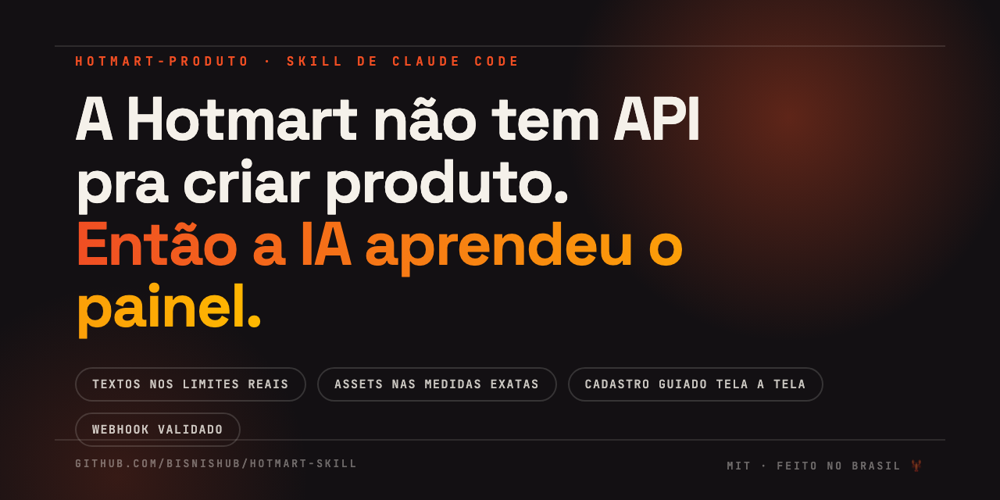

<p align="center">
  
</p>

<p align="center">
  <a href="LICENSE"></a>
  
  
  
</p>

# hotmart-produto

**A skill de Claude Code que lança produto na Hotmart do jeito certo.** A API da
Hotmart não cria produtos — cadastro é só no painel, na mão. Esta skill ensina a
IA a fazer o trabalho todo ANTES: textos dentro dos limites reais de cada campo,
imagens nas dimensões exatas, webhook sem sustos — e aí te guia tela a tela num
cadastro que não tem improviso.

> 💬 **Você:** "cadastra meu curso novo na Hotmart"
>
> 🤖 **Claude:** faz o briefing (e te avisa que o campo *Formato* trava pra
> sempre), escreve a descrição em ≤2000 caracteres e as vantagens em ≤500
> (validadas por script, não no olho), gera a capa 600×600 e o header do Club
> 2700×900 com o design da SUA marca, te guia pelo painel campo a campo, valida
> o webhook — e no final confere pela API que o produto tá no ar.

## Por que isso existe

Quem já cadastrou produto na Hotmart conhece a sequência: abre o painel →
descobre no meio do formulário que a descrição tem limite → escreve correndo →
a imagem tá no tamanho errado → exporta de novo → o campo *Formato* ficou errado
e **não dá mais pra mudar** → recria o produto. Uma tarde perdida.

Esta skill inverte: **preparação completa primeiro, painel depois.** Cada limite,
cada dimensão e cada pegadinha foi levantada por **inspeção real do painel**
(jul/2026) e validada num cadastro de verdade.

## O que vem dentro

| Peça | O que faz |
|---|---|
| 📋 `SKILL.md` | O fluxo completo: briefing → textos → assets → cadastro guiado → webhook → validação por API |
| 🗺️ `references/painel-cadastro.md` | Mapa tela a tela do painel (URLs, campos, limites, o que trava após criação) |
| 🔔 `references/webhook-eventos.md` | Webhook v2.0.0 por inteiro: os 16 eventos, payload anotado, dedupe, e o comportamento do botão de teste (que suja seu CRM se você não filtrar) |
| 🔑 `references/api-credenciais.md` | Credenciais, OAuth, o que a API cobre vs não cobre, e o MCP pra operar a conta conversando |
| 🖼️ `references/gerar-assets.md` | O método HTML → Chrome headless pra gerar assets pixel-perfect sem designer |
| 🎨 `templates/` | Capa **600×600** e header do Club **2700×900** prontos — troca as cores da marca e os textos |
| ⚙️ `scripts/validar-textos.py` | Valida TODOS os textos contra os limites reais (sai vermelho se o painel fosse cortar) |
| ⚙️ `scripts/gerar-asset.sh` | Fotografa o HTML, **confere as dimensões** e avisa se a capa passa dos 5 MB |
| 📦 `examples/produto-exemplo/` | Um produto fictício completo: briefing, textos validados e capa gerada — pra ver o resultado antes de usar |

### O resultado dos templates (gerado pelo próprio script)

<p align="center">
  
</p>

*Capa do produto de exemplo: template neutro + 4 edições de texto + 1 comando. 64 KB, 600×600 exatos.*

## Instalar

```bash
git clone https://github.com/bisnishub/hotmart-skill ~/.claude/skills/hotmart-produto
```

Pronto. No Claude Code: **"cadastra um produto novo na Hotmart"** — a skill assume.

## Os 5 erros que a skill impede

1. **Formato errado** — o único campo que NÃO pode ser editado depois (você descobriria tarde demais)
2. **Descrição estourada** — o painel corta em 2000 caracteres sem avisar direito
3. **Imagem fora de medida** — capa não é quadrada? Corta. Header fora de 2700×900? Estica
4. **Webhook que falha na validação** — a tela exige 200 no ping; endpoint que exige payload é recusado
5. **CRM sujo de teste** — o botão de teste da Hotmart cria compradores fictícios (`@example.com`) que viram leads/membros fantasma se você não filtrar

## O que esta skill NÃO é

- ❌ Não é automação 100% do painel — a Hotmart carrega o cadastro num iframe
  cross-origin que quebra automação de DOM; prometer robô ali é prometer coisa
  que quebra na primeira mudança de layout. O modo é **guiado**: você clica, a
  IA dita o conteúdo perfeito.
- ❌ Não substitui o [hotmart-mcp](https://github.com/thaleslaray/hotmart-mcp)
  do Thales Laray — **complementa**: o MCP opera a conta pela API (vendas,
  assinaturas, reembolsos); esta skill cobre o cadastro, que a API não alcança.
  Juntos, fecham o ciclo.

## Roadmap

- [ ] Templates de asset em mais proporções (banner de afiliado, capa de módulo do Club)
- [ ] Biblioteca de estruturas de descrição por nicho (curso, comunidade, evento, SaaS)
- [ ] Handler de webhook de referência (Supabase Edge Function) pronto pra colar

PRs e issues são bem-vindos — especialmente se o painel mudou e você mapeou a mudança.

---

Feito com 🦞 por **[Eduardo Cavalcanti](https://instagram.com/eduardocavalcanti)** ·
[Comunidade Claw Brasil](https://comunidadeopenclawbrasil.com.br) — a tribo dos
Maestros de Hiperagentes. Créditos ao [@thaleslaray](https://github.com/thaleslaray)
pelo MCP que fecha a outra metade do ciclo.
